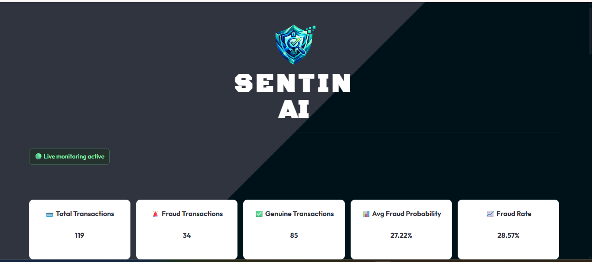
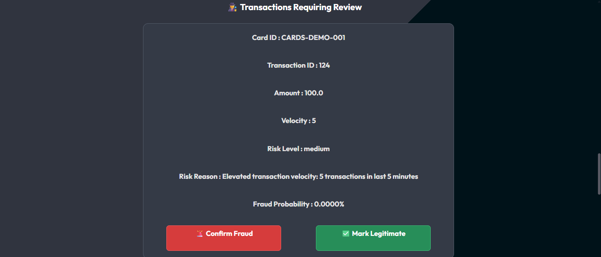
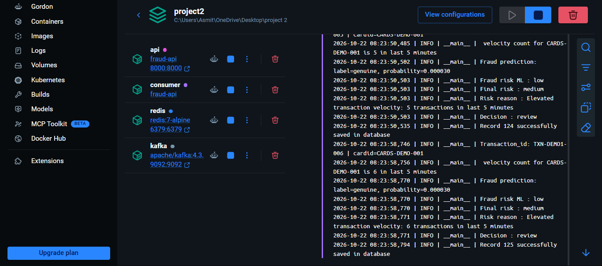

#  SentinAI
## Smart Shield.Secure Transactions

SentinAI is an end-to-end real-time fraud detection system that analyzes incoming financial transactions and identifies suspicious activity using machine learning and rule-based risk analysis.

The system uses an XGBoost fraud detection model together with transaction velocity monitoring to calculate the final risk level of a transaction. Based on the risk, the system automatically decides whether the transaction should be approved, sent for manual review, or blocked.

The project also includes a real-time dashboard where transactions, fraud alerts, risk levels, and pending analyst reviews can be monitored.

---

## 🚀 Key Features

- Real-time transaction ingestion using FastAPI
- Apache Kafka based transaction streaming
- XGBoost machine learning model for fraud prediction
- Redis based transaction velocity monitoring
- Rule-based Risk Engine
- Automatic Decision Engine
- PostgreSQL transaction storage
- Duplicate transaction protection
- Dead Letter Queue (DLQ) for failed Kafka messages
- Manual analyst review workflow
- Fraud monitoring dashboard using Streamlit
- API, PostgreSQL, Kafka, and Redis health monitoring
- Structured application logging
- Automated backend testing using Pytest
- Dockerized API, Kafka consumer, Kafka, and Redis services

---

## 🧠 Fraud Detection Flow

Each transaction passes through multiple layers before a final decision is generated:

1. Transaction is received through the FastAPI streaming endpoint.
2. FastAPI publishes the transaction to Apache Kafka.
3. Kafka Consumer receives and validates the transaction.
4. Redis calculates transaction velocity for the card.
5. XGBoost calculates the fraud probability.
6. Risk Engine combines ML risk and velocity rules.
7. Decision Engine generates the final action.
8. Transaction result is stored in PostgreSQL.
9. Medium and high-risk transactions can be sent for analyst review.
10. Dashboard displays transaction activity and fraud insights.

---

## ⚙️ Decision Logic

| Risk Level | Decision |
| Low | Approve |
| Medium | Review |
| High | Review |
| Critical | Block |

Transaction velocity is also used to increase risk when multiple transactions occur from the same card within a short period.

Example:

| Transactions in 5 Minutes | Risk Effect |
| 1–4 | No escalation |
| 5–6 | At least Medium |
| 7–9 | At least High |
| 10+ | Critical |

---

## 🛠️ Tech Stack

### Machine Learning
- Python
- XGBoost
- Scikit-learn
- Pandas
- Joblib

### Backend
- FastAPI
- Pydantic
- SQLAlchemy

### Real-Time Processing
- Apache Kafka
- Confluent Kafka Python Client

### Caching / Real-Time Features
- Redis

### Database
- PostgreSQL

### Dashboard
- Streamlit

### Testing
- Pytest
- FastAPI TestClient
- Mocking

### DevOps
- Docker
- Docker Compose

---

## 🤖 Machine Learning Model

The fraud detection model was trained on a highly imbalanced credit card transaction dataset.

The selected production model is an XGBoost classifier.

### Model Performance

| Metric | Score |
| ROC-AUC | 0.9910 |
| PR-AUC | 0.8940 |
| Fraud Precision | 0.8955 |
| Fraud Recall | 0.8451 |
| Fraud F1-Score | 0.8696 |

A custom classification threshold of approximately `0.1398` is used instead of the default `0.5` threshold to improve fraud detection performance.

The model prediction is not used alone. Its fraud probability is combined with transaction velocity rules through the Risk Engine.

---

## 🏗️ System Architecture

SentinAI uses an event-driven architecture for processing transactions in real time.

Client / Swagger / Dashboard
            |
            v
         FastAPI
            |
            v
      Apache Kafka
   fraud-transactions
            |
            v
      Kafka Consumer
            |
      +-----+------+
      |            |
      v            v
    Redis       XGBoost
  Velocity       Model
      |            |
      +-----+------+
            |
            v
       Risk Engine
            |
            v
     Decision Engine
            |
     +------+------+
     |      |      |
  Approve Review  Block
           |
           v
      PostgreSQL
           |
           v
   Streamlit Dashboard
           |
           v
     Analyst Review


     project/


# project Structure
│
├── src/
│   ├── api.py
│   ├── predictor.py
│   ├── database.py
│   ├── db_models.py
│   ├── kafka_producer.py
│   ├── kafka_consumer.py
│   ├── redis_client.py
│   ├── redis_features.py
│   ├── risk_engine.py
│   ├── decision_engine.py
│   ├── settings.py
│   └── logger.py
│
├── models/
│   ├── xgb_fraud_model.pkl
│   ├── feature_order.json
│   └── model_metadata.json
│
├── tests/
│   ├── test_predictor.py
│   ├── test_risk_engine.py
│   └── test_decision_engine.py
│
├── notebooks/
│   └── 01_eda.ipynb
│
├── dashboard.py
├── compose.yaml
├── Dockerfile
├── requirements.txt
├── pytest.ini
├── .dockerignore
├── .gitignore
└── README.md


---

## 🚀 Installation & Setup

### Prerequisites

Make sure the following are installed:

- Python 3.13+
- PostgreSQL
- Docker Desktop
- Git

---

## 💻 Local Development Setup

### 1. Clone the repository

```bash
git clone <your-repository-url>
cd <your-project-folder>
```

### 2. Create a virtual environment

Windows:

```bash
python -m venv .venv
.venv\Scripts\activate
```

### 3. Install dependencies

```bash
pip install -r requirements.txt
```

### 4. Configure environment variables

Create a `.env` file in the project root.

```env
DB_USER=your_postgres_user
DB_PASSWORD=your_postgres_password
DB_HOST=localhost
DB_PORT=5432
DB_NAME=your_database_name

KAFKA_BOOTSTRAP_SERVER=localhost:9092

REDIS_HOST=localhost
REDIS_PORT=6379
REDIS_DB=0
```

> Never commit the `.env` file or database credentials to GitHub.

### 5. Start Kafka and Redis

```bash
docker compose up -d kafka redis
```

### 6. Start FastAPI

```bash
uvicorn src.api:app --reload
```

API documentation:

```text
http://127.0.0.1:8000/docs
```

### 7. Start the Kafka Consumer

Open another terminal:

```bash
python -m src.kafka_consumer
```

### 8. Start the Dashboard

```bash
streamlit run dashboard.py
```

---

## 🐳 Docker Setup

The FastAPI service, Kafka consumer, Kafka broker, and Redis can also be started using Docker Compose.

PostgreSQL currently runs on the host machine and is accessed from Docker using `host.docker.internal`.

Build and start the services:

```bash
docker compose up -d --build
```

Check service status:

```bash
docker compose ps
```

Expected services:

```text
fraud-api
fraud-consumer
fraud-kafka
fraud-redis
```

### Create Kafka Topics

Create the transaction topic:

```bash
docker exec fraud-kafka /opt/kafka/bin/kafka-topics.sh \
--bootstrap-server localhost:9092 \
--create \
--topic fraud-transactions \
--partitions 3 \
--replication-factor 1
```

Create the Dead Letter Queue topic:

```bash
docker exec fraud-kafka /opt/kafka/bin/kafka-topics.sh \
--bootstrap-server localhost:9092 \
--create \
--topic fraud-dead-letter \
--partitions 3 \
--replication-factor 1
```

Verify topics:

```bash
docker exec fraud-kafka /opt/kafka/bin/kafka-topics.sh \
--bootstrap-server localhost:9092 \
--list
```

Expected:

```text
fraud-dead-letter
fraud-transactions
```

### Check Container Logs

Consumer logs:

```bash
docker logs fraud-consumer --tail 20
```

API logs:

```bash
docker logs fraud-api --tail 20
```

---

## ❤️ Health Check

The system provides a health endpoint for checking the main backend services.

```http
GET /health
```

Example response:

```json
{
  "status": "healthy",
  "services": {
    "api": "healthy",
    "postgresql": "healthy",
    "kafka": "healthy",
    "redis": "healthy"
  }
}
```

---

## 🔌 API Endpoints

| Method | Endpoint | Description |
|---|---|---|
| `GET` | `/health` | Check API, PostgreSQL, Kafka, and Redis health |
| `POST` | `/transactions/stream` | Submit a transaction for real-time processing |
| `GET` | `/transactions` | Retrieve recent processed transactions |
| `GET` | `/transactions/{transaction_id}` | Retrieve a specific transaction |
| `GET` | `/fraud/alerts` | Retrieve detected fraud alerts |
| `GET` | `/analytics/summary` | Retrieve dashboard analytics |
| `GET` | `/review/queue` | Retrieve transactions awaiting analyst review |
| `POST` | `/review/{transaction_id}` | Submit an analyst review decision |

---

## 📥 Streaming Transaction Example

Request:

```http
POST /transactions/stream
```

Example payload:

```json
{
  "Time": 8090.0,
  "V1": 0.0,
  "V2": 0.0,
  "V3": 0.0,
  "V4": 0.0,
  "V5": 0.0,
  "V6": 0.0,
  "V7": 0.0,
  "V8": 0.0,
  "V9": 0.0,
  "V10": 0.0,
  "V11": 0.0,
  "V12": 0.0,
  "V13": 0.0,
  "V14": 0.0,
  "V15": 0.0,
  "V16": 0.0,
  "V17": 0.0,
  "V18": 0.0,
  "V19": 0.0,
  "V20": 0.0,
  "V21": 0.0,
  "V22": 0.0,
  "V23": 0.0,
  "V24": 0.0,
  "V25": 0.0,
  "V26": 0.0,
  "V27": 0.0,
  "V28": 0.0,
  "Amount": 100.0,
  "transaction_id": "TXN-DEMO-001",
  "card_id": "CARD-DEMO-001"
}
```

Successful response:

```json
{
  "status": "accepted",
  "transaction_id": "TXN-DEMO-001",
  "message": "Transaction accepted for processing"
}
```

HTTP status:

```text
202 Accepted
```

---

## 🕵️ Manual Review API

Transactions with a `review` decision are added to the analyst review queue.

Get pending reviews:

```http
GET /review/queue
```

Resolve a transaction as confirmed fraud:

```http
POST /review/85
```

```json
{
  "verdict": "confirmed_fraud"
}
```

Or mark it legitimate:

```json
{
  "verdict": "legitimate"
}
```

After review:

```text
review_status = resolved
analyst_verdict = confirmed_fraud / legitimate
reviewed_at = timestamp
```

Resolved transactions are automatically removed from the pending review queue.

---

## 🧪 Automated Testing

The project includes automated tests using `pytest` for core fraud detection logic and API behavior.

Currently, the test suite contains **21 automated tests** covering:

- Risk Engine rules
- Decision Engine rules
- Genuine transaction prediction
- Fraud transaction prediction
- API health endpoint
- Transaction request validation
- Valid streaming requests
- Kafka failure handling
- Manual review validation
- Transaction not found handling
- Successful analyst review
- Protection against reviewing an already resolved transaction

Run all tests:

```bash
python -m pytest -v
```

Expected result:

```text
21 passed
```

Example test structure:

```text
tests/
├── test_api.py
├── test_predictor.py
├── test_risk_engine.py
└── test_decision_engine.py
```

Automated tests help ensure that changes to the project do not accidentally break the fraud detection workflow.

---

## 📊 Streamlit Dashboard

SentinAI includes a real-time monitoring dashboard built using Streamlit.

The dashboard displays:

- Total transactions
- Fraud transactions
- Genuine transactions
- Fraud rate
- Transaction classification
- Risk distribution
- Fraud probability trend
- Priority fraud alerts
- Recent transactions
- Pending manual reviews
- Transaction velocity
- Risk reasons
- Final transaction decisions

The dashboard can also be used by an analyst to resolve transactions that require manual review.

Available analyst actions:

```text
Confirm Fraud
Mark Legitimate
```

After an analyst submits a decision, the transaction is marked as resolved and removed from the pending review queue.

Start the dashboard:

```bash
streamlit run dashboard.py
```

---

## 🖥️ Dashboard Workflow

```text
Processed Transactions
        |
        v
     FastAPI
        |
        v
 Streamlit Dashboard
        |
   +----+----+
   |         |
Monitor    Review
Alerts     Queue
             |
       +-----+------+
       |            |
 Confirm Fraud   Legitimate
       |            |
       +-----+------+
             |
             v
      PostgreSQL Audit
```

---

## 📸 Screenshots

Create a folder in the project root:

```text
screenshots/
```

Recommended screenshots:

```text
screenshots/
├── dashboard-overview.png
├── review-queue.png
├── swagger-api.png
├── health-check.png
└── docker-services.png
```

### Dashboard



### Manual Review Queue



### FastAPI Swagger Documentation


### System Health Check


### Docker Services



---

## 🔄 Example End-to-End Flow

A transaction submitted through the streaming API follows this path:

```text
POST /transactions/stream

        |
        v

FastAPI Validation

        |
        v

Apache Kafka

        |
        v

Kafka Consumer

        |
        +----------------+
        |                |
        v                v

Redis Velocity      XGBoost Model

        |                |
        +--------+-------+
                 |
                 v

            Risk Engine

                 |
                 v

          Decision Engine

        +--------+--------+
        |        |        |
        v        v        v

     Approve   Review    Block

                 |
                 v

            PostgreSQL

                 |
                 v

       Streamlit Dashboard
```

---

## 🛡️ Reliability Features

SentinAI also includes several backend reliability features:

- Duplicate transaction protection using transaction IDs
- PostgreSQL unique constraint for transaction idempotency
- Kafka manual offset commits
- Dead Letter Queue for failed messages
- Redis rolling transaction velocity window
- API health monitoring
- Kafka delivery acknowledgement
- Structured application logging
- Automated regression tests

---

## 🚧 Current Project Scope

This project is designed as a portfolio-level real-time fraud detection system.

The current implementation focuses on:

- Machine learning based fraud detection
- Real-time event processing
- Rule-based risk analysis
- Transaction monitoring
- Analyst review workflow
- Backend reliability
- Dockerized local deployment

The project does not attempt to reproduce the full infrastructure of a production banking system.

---

## 🔮 Future Improvements

Possible future improvements include:

- Deploy the application to a cloud platform
- Add user authentication for the analyst dashboard
- Add role-based access for analysts and administrators
- Add model monitoring and drift detection
- Track model versions
- Add email or notification alerts for critical transactions
- Add more transaction behavioral features
- Add database migrations using Alembic
- Add CI/CD for automated testing
- Improve dashboard analytics

These features are intentionally kept outside the current scope to keep the project focused and maintainable.

---

## 🎯 What I Learned

Through this project, I worked with:

- Imbalanced machine learning classification
- Model threshold tuning
- XGBoost fraud prediction
- REST API development with FastAPI
- Event-driven processing using Kafka
- Redis based real-time features
- PostgreSQL and SQLAlchemy
- Business rule based risk engines
- Manual analyst review workflows
- API error handling
- Structured logging
- Automated testing with Pytest
- Mocking external dependencies
- Docker and Docker Compose
- Building an end-to-end ML application

## 🔐 Security Notes

Sensitive configuration such as database passwords is stored using environment variables.

The `.env` file is excluded from version control and should never be committed to GitHub.

An example configuration can be created locally using:

```env
DB_USER=your_database_user
DB_PASSWORD=your_database_password
DB_HOST=localhost
DB_PORT=5432
DB_NAME=your_database_name

KAFKA_BOOTSTRAP_SERVER=localhost:9092

REDIS_HOST=localhost
REDIS_PORT=6379
REDIS_DB=0
```

---

## 📌 Project Status

The core version of SentinAI is complete.

Implemented and tested:

- Machine learning fraud prediction
- Real-time Kafka transaction processing
- Redis velocity monitoring
- Risk and Decision Engines
- PostgreSQL persistence
- Dead Letter Queue
- Duplicate transaction protection
- Analyst review workflow
- Streamlit monitoring dashboard
- Health monitoring
- Structured logging
- Dockerized backend services
- Automated test suite

Current automated test result:

```text
21 passed
```

---

## 👨‍💻 Author

**Asmit**

Built as an end-to-end Machine Learning and Backend Engineering portfolio project.

Areas demonstrated:

- Machine Learning
- Python Backend Development
- REST APIs
- Event-Driven Architecture
- Databases
- Redis
- Docker
- Automated Testing

---

## ⭐ Repository

If you found this project useful, consider giving the repository a star.

Feedback and suggestions are welcome.