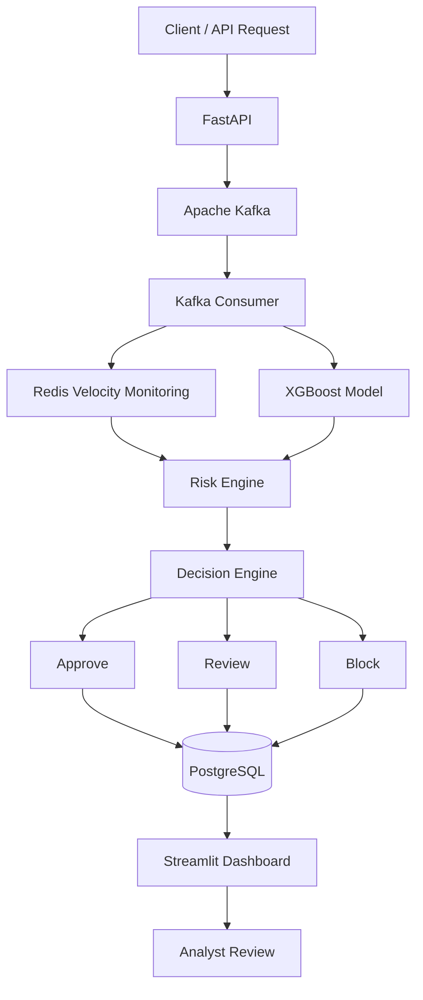
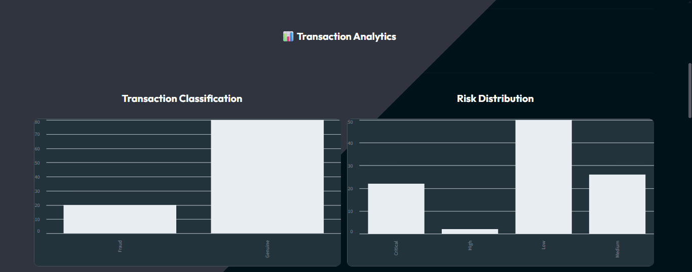

#  SentinAI

### Smart Shield. Secure Transactions.

SentinAI is an end-to-end real-time fraud detection system that combines Machine Learning and Rule-Based Risk Analysis to identify suspicious financial transactions in real time.

The platform leverages an XGBoost fraud detection model, Redis-based transaction velocity monitoring, and a decision engine to automatically classify transactions as:

- ✅ Approve
- ⚠️ Review
- ❌ Block

This project demonstrates practical experience with Machine Learning, FastAPI, Kafka, Redis, PostgreSQL, Docker, and Event-Driven Architecture.

---

## 🚀 Features

- Real-time transaction ingestion using FastAPI
- Apache Kafka event streaming
- XGBoost fraud prediction model
- Redis transaction velocity monitoring
- Rule-Based Risk Engine
- Automatic Decision Engine
- PostgreSQL transaction storage
- Duplicate transaction protection
- Dead Letter Queue (DLQ)
- Manual analyst review workflow
- Streamlit monitoring dashboard
- Health check endpoints
- Structured application logging
- Automated testing with Pytest
- Dockerized deployment

---

## 🏗️ System Architecture



---

## 🔄 Fraud Detection Workflow

1. Transaction received through FastAPI
2. Transaction published to Kafka
3. Kafka Consumer processes the event
4. Redis calculates transaction velocity
5. XGBoost predicts fraud probability
6. Risk Engine combines ML and rule-based signals
7. Decision Engine generates a final decision
8. Transaction is stored in PostgreSQL
9. Dashboard displays transaction insights
10. Analysts review flagged transactions

---

## ⚙️ Decision Logic

| Risk Level | Decision |
|------------|-----------|
| Low | Approve |
| Medium | Review |
| High | Review |
| Critical | Block |

### Velocity Escalation Rules

| Transactions (5 Minutes) | Risk Escalation |
|-------------------------|----------------|
| 1–4 | No Escalation |
| 5–6 | Medium |
| 7–9 | High |
| 10+ | Critical |

---

## 🤖 Machine Learning Model

### Production Model

- XGBoost Classifier
- Trained on an imbalanced credit-card fraud dataset
- Threshold optimized for fraud detection performance

### Performance Metrics

| Metric | Score |
|----------|----------|
| ROC-AUC | 0.9910 |
| PR-AUC | 0.8940 |
| Precision | 0.8955 |
| Recall | 0.8451 |
| F1 Score | 0.8696 |

A custom classification threshold of **0.1398** is used instead of the default 0.5 threshold.

The ML prediction is combined with transaction velocity rules before generating the final fraud decision.

---

## 🛠️ Tech Stack

### 🤖 Machine Learning & Data Science

- Python
- Pandas
- Seaborn
- Scikit-learn
- XGBoost
- SHAP
- Joblib

### ⚡ Backend & API

- FastAPI
- Uvicorn
- SQLAlchemy
- Pydantic
- python-dotenv

### 🗄️ Database

- PostgreSQL
- psycopg2-binary

### 🔄 Real-Time Processing

- Apache Kafka
- Confluent Kafka Python Client

### 🚀 Caching & Real-Time Features

- Redis

### 📊 Dashboard & Visualization

- Streamlit
- Requests

### 🧪 Testing

- Pytest
- HTTPX

### 🐳 DevOps

- Docker
- Docker Compose
---

## 📁 Project Structure

```text
project/
│
├── src/
│   ├── api.py
│   ├── predictor.py
│   ├── database.py
│   ├── db_models.py
│   ├── kafka_producer.py
│   ├── kafka_consumer.py
│   ├── redis_client.py
│   ├── redis_features.py
│   ├── risk_engine.py
│   ├── decision_engine.py
│   ├── settings.py
│   └── logger.py
│
├── models/
│   ├── xgb_fraud_model.pkl
│   ├── feature_order.json
│   └── model_metadata.json
│
├── tests/
│   ├── test_predictor.py
│   ├── test_risk_engine.py
│   └── test_decision_engine.py
│
├── notebooks/
│   └── 01_eda.ipynb
│
├── dashboard.py
├── compose.yaml
├── Dockerfile
├── requirements.txt
├── pytest.ini
├── README.md
```

---

## 🚀 Quick Start

### Clone Repository

```bash
git clone https://github.com/<your-username>/SentinAI.git

cd SentinAI
```

### Create Virtual Environment

```bash
python -m venv .venv
```

Windows

```bash
.venv\Scripts\activate
```

### Install Dependencies

```bash
pip install -r requirements.txt
```

### Configure Environment Variables

Create a `.env` file:

```env
DB_USER=postgres
DB_PASSWORD=password
DB_HOST=localhost
DB_PORT=5432
DB_NAME=fraud_db

KAFKA_BOOTSTRAP_SERVER=localhost:9092

REDIS_HOST=localhost
REDIS_PORT=6379
REDIS_DB=0
```

### Start Kafka and Redis

```bash
docker compose up -d kafka redis
```

### Start FastAPI

```bash
uvicorn src.api:app --reload
```

API Docs

```text
http://127.0.0.1:8000/docs
```

### Start Kafka Consumer

```bash
python -m src.kafka_consumer
```

### Start Dashboard

```bash
streamlit run dashboard.py
```

---

## 🐳 Docker Deployment

Build and start services:

```bash
docker compose up -d --build
```

Check running containers:

```bash
docker compose ps
```

Expected Services:

```text
fraud-api
fraud-consumer
fraud-kafka
fraud-redis
```

---

## ❤️ Health Check

```http
GET /health
```

Example Response

```json
{
  "status": "healthy",
  "services": {
    "api": "healthy",
    "postgresql": "healthy",
    "kafka": "healthy",
    "redis": "healthy"
  }
}
```

---

## 🔌 API Endpoints

| Method | Endpoint | Description |
|----------|----------|----------|
| GET | /health | System health |
| POST | /transactions/stream | Submit transaction |
| GET | /transactions | Recent transactions |
| GET | /transactions/{id} | Get transaction |
| GET | /fraud/alerts | Fraud alerts |
| GET | /analytics/summary | Dashboard analytics |
| GET | /review/queue | Pending reviews |
| POST | /review/{id} | Analyst review |

---

## 📥 Sample Transaction

```json
{
  "Time": 8090.0,
  "Amount": 100.0,
  "transaction_id": "TXN-DEMO-001",
  "card_id": "CARD-DEMO-001"
}
```

Response

```json
{
  "status": "accepted",
  "transaction_id": "TXN-DEMO-001",
  "message": "Transaction accepted for processing"
}
```

---

## 🧪 Testing

Run all tests:

```bash
pytest
```

Current Test Result

```text
11 Passed
```

---

## 📊 Dashboard

The Streamlit dashboard provides:

- Transaction Monitoring
- Fraud Alerts
- Fraud Probability Trends
- Risk Analytics
- Review Queue Management
- Analyst Investigation Workflow
- Recent Transactions
- Transaction Statistics

### Screenshots

```text
screenshots/
├── dashboard-overview.png
├── review-queue.png
├── dashboard-recent-transaction.png
├── transaction-analytics.png
└── docker-services.png
```

### Dashboard Overview


### Manual Review Queue


### Recent Transaction


### Transaction Analytics



### Docker Services


---

## 🎯 Key Learnings

Through SentinAI I gained hands-on experience with:

- Fraud Detection Systems
- Imbalanced Classification Problems
- XGBoost Model Deployment
- Threshold Optimization
- FastAPI Backend Development
- Kafka Event Streaming
- Redis Real-Time Features
- PostgreSQL & SQLAlchemy
- Rule-Based Risk Engines
- Analyst Review Workflows
- Dockerized Infrastructure
- Automated Testing
- End-to-End ML System Design

---

## 📌 Project Status

### Implemented

- ✅ Fraud Prediction Model
- ✅ Kafka Streaming Pipeline
- ✅ Redis Velocity Monitoring
- ✅ Risk Engine
- ✅ Decision Engine
- ✅ PostgreSQL Persistence
- ✅ Dead Letter Queue
- ✅ Duplicate Transaction Protection
- ✅ Analyst Review Workflow
- ✅ Streamlit Dashboard
- ✅ Health Monitoring
- ✅ Structured Logging
- ✅ Docker Deployment
- ✅ Automated Testing

### Current Test Status

```text
11 Passed
```

---

## 👨‍💻 Author

**Asmit**

Built as an end-to-end Machine Learning and Backend Engineering portfolio project.

### Areas Demonstrated

- Machine Learning
- Python Backend Development
- FastAPI
- Apache Kafka
- Redis
- PostgreSQL
- Event-Driven Architecture
- Docker
- Automated Testing

---

⭐ If you found this project interesting